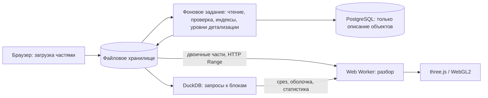
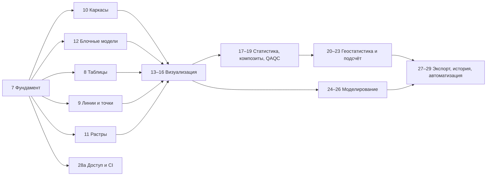

# План разработки BedrockForge (редакция 2, 2026-11-14)

ГГИС уровня Micromine / Surpac / Datamine / Leapfrog в браузере.

Редакция 2 меняет приоритеты прежнего плана. Три требования стоят выше любого нового функционала:

| Требование | Что это значит на практике |
|---|---|
| **Точность** | Результат любого расчёта воспроизводим, сверен с эталоном и имеет записанный допуск |
| **Базовый функционал промышленной ГГИС** | Закрыт полный цикл геолога: данные → проверка → разрезы → каркасы → блочная модель → подсчёт → отчёт |
| **Производительность** | Каркасы от 200 МБ и блочные модели до 2 ГБ открываются и режутся без ожидания |

Нумерация этапов 7–29 сохранена, чтобы ссылки из `docs/HANDOFF.md` оставались верными. Изменились состав этапов и их порядок.

## 1. Состояние

| Этап | Сделано | Чего не хватает |
|---|---|---|
| 0–6 | Импорт скважин (DAT, CSV, Excel), PostgreSQL, аудит (27 правил), 3D, лента, Claude, MCP | Авторизация, сохранение диалогов |
| 7 | Файловое хранилище, загрузка частями до 4 ГБ, фоновые задания, двоичная передача, замеры и CI, мастер импорта с предпросмотром, папки и удаление в дереве | Импорт таблиц скважин пока идёт в запросе, а не заданием (этап 8) |
| 9 (часть) | Линии: Micromine STR, Surpac STR (текст), DXF | Точки, DWG, двоичный Surpac STR |
| 10 (часть) | Каркасы: TRIDB, DXF; площадь, объём, замкнутость; сечение плоскостью | Surpac DTM, Datamine, OBJ, STL; самопересечения; большие файлы |
| 11 (часть) | Растры: GeoTIFF, world-файл, TAB, GRF; вертикальные растры | Привязка по опорным точкам в UI, тайлы |
| 12 | Заглушка в дереве | Всё |
| 17, 20 (часть) | `api/app/stats/`: декластеризация, нормальные метки, вариограммы, карта вариограмм, bootstrap, IDW; вкладка статистики | Сверка с эталонами, инструменты для Claude/MCP |

### 1.1. Что в текущем коде не выдержит целевых объёмов

Это главная причина новой редакции. Все пункты проверены по коду ветки `base-functional`. Статус на конец этапа 7 — в последней колонке.

| Место | Было | Почему не подходит | После этапа 7 |
|---|---|---|---|
| `models.py`: `Wireframe.vertices`, `.triangles`, `Raster.image` | Геометрия в поле `BYTEA` PostgreSQL | Предел поля 1 ГБ; поле читается в память целиком; нет чтения по частям | Решено: файловое хранилище, `memmap` |
| `routers/datasets.py`: `wireframe_geometry` | JSON с base64 | +33 % к объёму; каркас в 10 млн треугольников даёт строку ~240 МБ, близко к пределу длины строки V8 (~512 МБ) | Решено: `/api/blobs/{sha256}`, Range, Web Worker |
| `routers/datasets.py`: `upload_*` | Импорт выполняется внутри HTTP-запроса | Запрос висит минуты, нет прогресса и отмены, один импорт занимает рабочий процесс API | Решено для каркасов, линий, растров; скважины — этап 8 |
| `formats/wireframes.py`: `weld`, `mesh_stats` | `np.unique(axis=0)` по строкам | Сортировка строк: медленно и с кратным расходом памяти на миллионах вершин | Решено: 10 млн треугольников — 3,6 с и 0,85 ГБ (было ~23 с и 1,6 ГБ) |
| `viz/scene3d.ts` | Сечение каркасов считается в основном потоке браузера | Интерфейс замирает на больших сетках | Открыто: этап 10.5 |
| `viz/scene3d.ts` | Начало координат сцены — по первому объекту | Объект далеко от первого теряет точность float32 | Решено: у каждого объекта своё начало, буферы без копирования |
| Блочные модели | Нет хранилища и читателей | — | Открыто: этап 12 (генератор синтетики есть) |
| Репозиторий | Нет CI, нет замеров скорости | Регрессии по точности и скорости не ловятся | Решено: `bench/`, `.github/workflows/ci.yml` |

## 2. Целевые показатели

### 2.1. Расчётные объёмы

Оценки получены из структуры форматов; их нужно подтвердить на реальных файлах (раздел 9).

| Объект | Размер файла | Оценка содержимого | Расчётный предел системы |
|---|---|---|---|
| Каркас TRIDB | 200–300 МБ | 24 байта на вершину + 12 на треугольник: около 4–5 млн вершин, 8–10 млн треугольников | 10 млн треугольников в одном каркасе, 30 млн в сцене |
| Каркас DXF | 200 МБ | Текстовый формат: 1–2 млн треугольников | То же |
| Блочная модель | до 2 ГБ | 60–200 байт на блок в зависимости от формата: 10–30 млн блоков | 30 млн блоков, 50 атрибутов |

### 2.2. Бюджеты скорости

Это цели. Замеры этапа 7.5 (`api/bench/`) для части операций — в таблице 2.4; остальные появятся на этапах 10 и 12. Опорное оборудование (допущение, см. раздел 9): сервер 8 ядер / 32 ГБ, рабочее место 16 ГБ ОЗУ и дискретная видеокарта 4 ГБ.

| Операция | Каркас 10 млн треугольников | Блочная модель 30 млн блоков |
|---|---|---|
| Импорт до готовности | ≤ 60 с, память сервера ≤ 2 ГБ | ≤ 10 мин, потоково, память ≤ 4 ГБ |
| Первое изображение в сцене | ≤ 3 с (грубый уровень детализации) | ≤ 3 с (срез или оболочка) |
| Полная детализация | ≤ 15 с | по запросу, только видимая часть |
| Вращение | ≥ 30 кадров/с при 30 млн треугольников в сцене | ≥ 30 кадров/с |
| Точное сечение плоскостью | ≤ 1 с; шаг профиля ≤ 300 мс | ≤ 1 с |
| Фильтр по атрибутам + оболочка | — | ≤ 3 с |
| Статистика по атрибуту, кривая «содержание–тоннаж» | — | ≤ 2 с |
| Запрос объекта по клику | ≤ 50 мс | ≤ 100 мс |
| Память вкладки браузера | ≤ 2 ГБ на всю сцену | ≤ 2 ГБ на всю сцену |

### 2.3. Требования к точности

| Область | Правило | Проверка |
|---|---|---|
| Хранение координат | Только float64, без округления при импорте | Импорт → экспорт: координаты совпадают побитно |
| Видеокарта | float32 относительно начала координат объекта в центре его охвата. Объект до 16 км в поперечнике (до 8 км от начала): погрешность ≤ 0,5 мм; объект крупнее делится на части со своим началом | Тест: 200 тыс. точек на 16 км в координатах UTM, ошибка ≤ 0,5 мм |
| Измерения, запрос по клику, сечения | Считаются по данным float64, а не по буферам видеокарты | Тест: длина и площадь на UTM-координатах |
| Объём и площадь каркаса | Знаковые тетраэдры от центра охвата, попарное суммирование | Сверка с полями `Volume`, `SurfaceArea` из TRIDB, относительный допуск 1e-9 |
| Траектории скважин | Метод минимальной кривизны (есть, этап 5) | Существующие эталонные тесты |
| Блочная модель | Объём блоков = сумма размеров; субблоки не перекрываются | Сверка суммарного объёма с объёмом каркаса-ограничителя |
| Геостатистика | Вариограммы, кригинг, IDW совпадают с эталоном | Наборы GSLIB; результаты Micromine на данных проекта; допуск записан в тесте |
| Системы координат | EPSG хранится у каждого объекта; пересчёт только по явной команде через `pyproj` | Тест прямого и обратного пересчёта |
| Пропуски и пределы обнаружения | `NaN`, пусто, `-999`, `<0.01` разбираются по правилам, заданным при импорте, и не превращаются молча в ноль | Тесты читателей |
| Воспроизводимость | Каждый расчётный объект хранит параметры, версию алгоритма, хеш входных данных и зерно случайных чисел | Повтор расчёта даёт тот же результат |
| Упрощение для показа | Упрощённая геометрия используется только для рисования и помечается в интерфейсе; расчёты идут по исходной | Тест: объём не зависит от уровня детализации |

### 2.4. Замеры после этапа 7

Машина разработки: 4 ядра, 15 ГБ ОЗУ. Синтетический замкнутый куб на координатах UTM; объём и площадь сходятся с аналитическими точно.

| Операция | 1 млн треугольников | 10 млн треугольников | Бюджет (10 млн) |
|---|---|---|---|
| Статистика каркаса (площадь, объём, рёбра) | 0,31 с / 268 МБ | 3,6 с / 0,85 ГБ | 20 с / 2 ГБ |
| Запись в хранилище с копией для показа | 0,15 с / 113 МБ | 1,4 с / 383 МБ | 15 с / 1 ГБ |
| Импорт TRIDB целиком | 0,68 с / 335 МБ | 6,5 с / 0,9 ГБ | 60 с / 2 ГБ |
| Отдача буферов для показа по HTTP | 0,13 с | 0,85 с | 5 с |
| Загрузка частями | 256 МБ — 1,4 с | 2 ГБ — 11,6 с / 281 МБ | 120 с / 0,5 ГБ |

Не измерено: отрисовка и вращение в браузере (зависят от видеокарты), сечения на сервере (этап 10.5), блочные модели (этап 12).

## 3. Архитектура для больших данных

### 3.1. Поток данных

### 3.2. Решения

| Вопрос | Решение | Заменяет |
|---|---|---|
| Хранение геометрии и таблиц | Файлы на диске (том Docker; позже S3-совместимое хранилище), адресация по SHA-256. В PostgreSQL — только описание, охват, статистика | `BYTEA` |
| Загрузка файлов | Частями по 8–16 МБ с докачкой, сразу на диск, предел 4 ГБ | Один запрос с файлом в памяти |
| Фоновые задания | Отдельные рабочие процессы; очередь в PostgreSQL (`SELECT … FOR UPDATE SKIP LOCKED`), прогресс по SSE, отмена, журнал. Новые службы (Redis и т. п.) не нужны | Импорт внутри запроса |
| Передача в браузер | `application/octet-stream`, HTTP Range, `ETag`, неизменяемый кеш; разбор в Web Worker, передача буферов без копирования | JSON + base64 |
| Каркас на диске | Исходные массивы float64 / uint32 (чтение через `mmap`) + производные: пространственные части по ~64 тыс. треугольников, 3 уровня детализации, BVH | Два поля в таблице |
| Сечение каркаса | Точное — на сервере по float64 с пространственным индексом; мгновенный предпросмотр — плоскости отсечения на клиенте | Расчёт в основном потоке браузера |
| Отрисовка каркасов | Отбор частей по пирамиде видимости, уровни детализации по расстоянию, плоское затенение без массива нормалей, кадр рисуется только при изменении | Одна сплошная сетка |
| Запрос по клику, измерения | BVH (`three-mesh-bvh`) в Worker, уточнение по float64 | Перебор треугольников |
| Блочная модель на диске | Parquet (zstd), строки отсортированы по коду Мортона от IJK, группы строк по ~1 млн; статистика групп отсекает ненужное чтение | — |
| Запросы к блокам | DuckDB поверх Parquet: фильтры, срезы, агрегаты, «содержание–тоннаж» | — |
| Показ блочной модели | Сервер отдаёт только видимое: грани среза или внешние грани отфильтрованных блоков. Цвет — атрибут float32 + таблица цветов в текстуре: смена легенды не пересылает геометрию | Отрисовка всех блоков |
| Ограничение объёма показа | Если видимых граней больше 5 млн, сервер объединяет до родительских блоков, интерфейс показывает пометку «упрощено» | — |
| Чтение Micromine DAT | Записи фиксированной длины → `numpy.memmap` со структурным типом, без разбора по строкам | Построчное чтение |
| Чтение CSV | Потоковое, `pyarrow.csv` / DuckDB | `pandas` целиком в память |
| Тяжёлые расчёты | `numpy` + `numba`, блочная обработка, несколько процессов | — |
| Растры | `rasterio` (GDAL), пирамида тайлов (COG) | `BYTEA` с копией для показа |

Новые зависимости: `duckdb`, `pyarrow`, `numba`, `rasterio`, библиотека упрощения сеток (`meshoptimizer` или `pyfqmr` — выбрать по замеру), на клиенте `three-mesh-bvh`.

## 4. Порядок реализации

| Веха | После этапов | Критерий приёмки |
|---|---|---|
| **M0 «Фундамент»** | 7 | Файл 2 ГБ загружается с докачкой; задание идёт с прогрессом и отменяется; замеры скорости работают в CI |
| **M1 «Большие каркасы»** | 10 | Каркас 10 млн треугольников укладывается в бюджеты 2.2; объём совпадает с TRIDB в пределах допуска |
| **M2 «Большие блочные модели»** | 12 | Модель 30 млн блоков: импорт, срез, фильтр, статистика — в бюджетах 2.2 |
| **M3 «Все данные загружаются»** | 8, 9, 11 | Скважины, точки, линии, каркасы, растры, блоки — в одном проекте |
| **M4 «Рабочее место геолога»** | 16 | Слои, легенды, серии разрезов, запросы, измерения, печать |
| **M5 «Анализ данных»** | 19 | Статистика, композиты, QAQC, сверка с эталонами |
| **M6 «Оценка ресурсов»** | 23 | Вариограммы, оценка, валидация, отчёт по ресурсам |
| **M7 «Моделирование»** | 26 | Оцифровка, операции с каркасами, неявные модели |

Размер этапов: S — малый, M — средний, L — большой. Сроки в неделях не указаны: скорость работы на этом проекте ещё не измерялась.

## 5. Фаза A. Фундамент и данные

### Этап 7. Фундамент (L) — первым, без исключений

| Часть | Состав | Приёмка |
|---|---|---|
| 7.1 Хранилище | Файловое хранилище с адресацией по хешу; перенос геометрии каркасов, линий и растров из `BYTEA` миграцией; сборка мусора | Старые проекты открываются после миграции |
| 7.2 Загрузка | Загрузка частями с докачкой и контрольной суммой; предел 4 ГБ | Обрыв сети на 1,5 ГБ из 2 ГБ: загрузка продолжается |
| 7.3 Задания | Очередь в PostgreSQL, рабочие процессы, прогресс по SSE, отмена, журнал, повтор после сбоя; панель заданий в интерфейсе | Перезапуск API не теряет задание |
| 7.4 Двоичная передача | Эндпоинты с Range и ETag; разбор в Web Worker; начало координат у каждого объекта | Ни одного base64 в передаче геометрии |
| 7.5 Замеры и эталоны | Генераторы синтетических данных (сетка 10 млн треугольников, модель 30 млн блоков); набор замеров; набор эталонов точности; CI: тесты + пороги скорости | Замедление больше 20 % останавливает слияние |
| 7.6 Мастер импорта | Определение формата → параметры → предпросмотр → задание; реестр форматов с единым интерфейсом `detect / inspect / read` | Все существующие форматы идут через мастер |
| 7.7 Дерево | Папки, переименование, удаление объектов и проектов | — |

### Этап 10. Каркасные модели (L)

| Часть | Состав |
|---|---|
| 10.1 Чтение больших файлов | TRIDB: чтение BLOB частями прямо в файлы массивов. DXF: потоковый разбор (`ezdxf.addons.iterdxf`), без загрузки документа в память |
| 10.2 Сшивка и проверка | Сшивка вершин через пространственную сетку вместо `np.unique`; замкнутость, согласованность нормалей, вырожденные треугольники, самопересечения (BVH); объём и площадь |
| 10.3 Производные данные | Пространственные части, 3 уровня детализации, BVH — считаются один раз при импорте |
| 10.4 Отрисовка | Отбор по видимости, уровни детализации, постепенная подгрузка от грубого к точному |
| 10.5 Сечения | Точное сечение на сервере, замыкание контуров, кеш по профилям серии |
| 10.6 Остальные форматы | Surpac DTM + STR, Datamine (треугольники + точки), OBJ, STL |

### Этап 12. Блочные модели (L)

| Часть | Состав |
|---|---|
| 12.1 Читатели | Micromine DAT (`memmap`), Datamine DM (страничный, одинарная и расширенная точность), CSV / текст (потоково). Запись в Parquet порциями |
| 12.2 Описание модели | Начало, размер родительского блока, число блоков, субблоки, поворот; определение сетки по данным; поворот задаётся при импорте, если его нет в файле |
| 12.3 Проверка | Перекрытия, пропуски, блоки вне сетки, пустые атрибуты, сверка объёма |
| 12.4 Запросы | Срез произвольной плоскостью, фильтр по выражению, внешние грани, агрегаты, «содержание–тоннаж» |
| 12.5 Отрисовка | Срезы и оболочки, цвет по атрибуту через текстуру легенды, запрос блока по клику |
| 12.6 Сводка | Число блоков, объём, статистика по атрибутам, отчёт по бортам |

### Этапы 8, 9, 11 (M каждый)

| Этап | Состав |
|---|---|
| 8. Таблицы | Произвольные интервальные таблицы (литология, плотность, геотехника); точечные таблицы; DAT любой структуры; `.xls`; режимы «заменить / дополнить / обновить по ключу»; шаблоны импорта; справочники кодов с цветами и штриховками; правила аудита для новых таблиц; правила для пропусков и пределов обнаружения |
| 9. Линии и точки | DXF (POINT, LINE, POLYLINE, LWPOLYLINE, TEXT), точки, двоичный Surpac STR, DWG через внешний конвертер |
| 11. Растры | Привязка по опорным точкам в интерфейсе (план: 2–4 точки; разрез: 3 точки) с показом отклонений; пирамида тайлов; рельеф из GeoTIFF → поверхность; натягивание на ЦМР |

### Этап 28a. Доступ и эксплуатация (M) — перенесён из фазы F

Без этого систему нельзя выставлять в сеть: сейчас у API и MCP авторизации нет.

- Авторизация, роли (просмотр / редактирование / администратор), доступ по проектам.
- Резервное копирование PostgreSQL и файлового хранилища, проверка восстановления.
- Журналирование, метрики заданий и запросов, ограничение размера и частоты запросов.
- Сборка и развёртывание: образы с фиксированными версиями зависимостей, миграции при запуске.

## 6. Фаза B. Рабочее место геолога

| Этап | Состав | Размер |
|---|---|---|
| 13. Слои и формы отображения | Единый список слоёв; цвет по атрибуту, размер, толщина, прозрачность, подписи; редактор легенд (интервалы, категории, наборы цветов проекта); фильтры по выражениям (`AU >= 0.5 AND LITH = 'QV'`); сохранённые сцены | M |
| 14. Разрезы и срезы | Менеджер разрезов: серии по профилям, коридор, произвольная плоскость; сечение каркасов и блочной модели; план на уровне; растры в разрезе | M |
| 15. Большие сцены | Сведение этапов 10.4 и 12.5 в одну сцену: общий бюджет памяти, очередь подгрузки, 10 тыс. скважин одной геометрией, подписи по масштабу | M |
| 16. Объекты и вывод | Запрос по клику (блок, треугольник, интервал); измерения: расстояние, угол, площадь, азимут и падение; графики содержаний вдоль ствола, литология штриховкой; печать листа разреза или плана с рамкой, сеткой, масштабом и легендой → PDF, SVG, PNG | L |

## 7. Фазы C–F

### Фаза C. Статистика и подготовка данных

| Этап | Состав | Состояние |
|---|---|---|
| 17. Статистика | Описательная статистика по доменам; гистограмма (в т. ч. логарифмическая); накопленная вероятность; ящики с усами; рассеяние с регрессией; корреляции; Q-Q; связь выделения с 3D | Часть есть в `app/stats`; нужна сверка с эталонами |
| 18. Композиты и домены | Композитирование по длине, уступам, геологии; кодирование проб каркасами (точка-в-теле через BVH); объединение интервальных таблиц; ураганные пробы; декластеризация | Декластеризация есть |
| 19. QAQC | Стандарты (контрольные карты), бланки, дубликаты (рассеяние, HARD, Томпсон–Ховарт), сводный отчёт | — |

### Фаза D. Геостатистика и подсчёт ресурсов

| Этап | Состав | Состояние |
|---|---|---|
| 20. Вариография | Всенаправленные, направленные, вдоль скважин; карта вариограмм; интерактивная подгонка (самородок + до трёх структур); эллипсоид анизотропии в 3D | Расчёт есть; подгонка и эллипсоид — нет |
| 21. Оценка | Пустая модель по каркасам с субблоками; кодирование; NN, IDW, обычный и простой кригинг; эллипсоид поиска, проходы, секторы, ограничение по скважинам; перекрёстная проверка; анализ окрестности. Расчёт блоками по группам строк Parquet, несколько процессов, задание с прогрессом | IDW есть |
| 22. Валидация | Swath plot по X, Y, Z; глобальная статистика; «содержание–тоннаж»; сравнение гистограмм | — |
| 23. Классификация и отчёт | Категории по проходу, расстоянию, числу проб или каркасу; плотность; тоннаж, содержание, металл по доменам, категориям и бортам; отчёт Excel и PDF | — |

Цель по скорости для этапа 21: обычный кригинг 5 млн блоков по 100 тыс. композитов — задание с прогрессом, результат побитно одинаков при любом числе процессов.

### Фаза E. Моделирование

| Этап | Состав |
|---|---|
| 24. Линии и поверхности | Оцифровка в плане и разрезе с привязкой к объектам; редактирование; ЦМР из точек и линий; изолинии; объём между поверхностями |
| 25. Операции с каркасами | Сшивка контуров разрезов в тело; булевы операции; обрезка поверхностью; исправление ошибок |
| 26. Неявное моделирование | RBF по контактам и содержаниям; оболочки литологии и содержаний; анизотропия и тренды |

### Фаза F. Платформа

| Этап | Состав |
|---|---|
| 27. Экспорт | CSV, Excel, Micromine DAT и STR, DXF, Datamine DM, OBJ, GeoTIFF; архив проекта. Проверка «импорт → экспорт → импорт» без потери точности |
| 28b. История | История изменений объектов, отмена действий, пересчёт систем координат |
| 29. Автоматизация Claude | Инструменты статистики и геостатистики для Claude и MCP; запись журнала команд в повторяемый сценарий; отчёты по запросу; сохранение диалогов |

Вне плана: проектирование карьеров и подземных выработок, планирование горных работ, маркшейдерские задачи.

## 8. Правило завершения этапа

Этап закрыт, когда выполнено всё:

- чтение или расчёт в `api/` с тестами на синтетических данных;
- **тест точности** против эталона с записанным допуском;
- **замер скорости** на расчётном объёме, результат в пределах бюджета 2.2;
- проверка на реальных файлах проекта (в git не попадают);
- эндпоинты API и экран или слой в интерфейсе;
- команды в `web/src/shell/registry.ts` — их сразу получают лента, палитра, Claude и MCP;
- инструмент чтения данных в `api/app/assistant/tools.py`;
- миграция БД, обратимая и проверенная на копии рабочих данных;
- раздел в `README.md`, обновление `docs/HANDOFF.md`.

Один этап или его часть (7.1, 10.2 …) — одна ветка и один pull request.

## 9. Риски и что нужно от пользователя

### 9.1. Риски

| Риск | Суть | Мера |
|---|---|---|
| Оценки объёмов неверны | Число треугольников и блоков выведено из размера файла, а не измерено | Получить реальные файлы до начала этапов 10 и 12; до этого — синтетика |
| Память браузера | Вкладка ограничена, 30 млн треугольников на грани | Уровни детализации, отбор по видимости, общий бюджет памяти сцены (этап 15) |
| Datamine DM | Читатель пишется свой; варианты формата различаются | Образцы обеих точностей; сверка с экспортом в CSV из Datamine |
| Форматы Micromine | STR, блочные DAT, TRIDB публично не описаны | Разбор по образцам, как сделано для DAT и TRIDB |
| DWG | Формат закрытый | ODA File Converter как необязательный компонент; без него — «сохраните в DXF» |
| Сверка с Micromine | Без эталонных результатов точность геостатистики не доказать | Вариограммы, оценённая модель и swath plot из Micromine на тех же данных |
| Миграция `BYTEA` → файлы | Затрагивает существующие проекты | Обратимая миграция, проверка на копии |
| Стандарт отчётности | ГКЗ, JORC или оба | Решить до этапа 23 |

### 9.2. Нужно от пользователя

| К этапу | Что | Получено |
|---|---|---|
| 7 | Оборудование: характеристики сервера и рабочих мест; один пользователь или несколько одновременно | — |
| 10 | Каркас больше 200 МБ (TRIDB и/или DXF), желательно с известным объёмом | `Pit.tridb`, `TST-FAULTS.DXF` — малые |
| 12 | Блочная модель 1–2 ГБ: Micromine DAT, Datamine DM, текст; параметры поворота | — |
| 8 | Таблицы литологии, плотности, QAQC; справочник кодов | — |
| 9 | DWG, Surpac STR и DTM | Micromine STR |
| 11 | Сканы разрезов без привязки | JPG + JGW, TAB, GRF |
| 20–22 | Вариограммы, оценённая модель и swath plot из Micromine для сверки | — |
| 23 | Форма отчёта по ресурсам | — |

Разбор полученных образцов — в `docs/FORMATS.md`.
