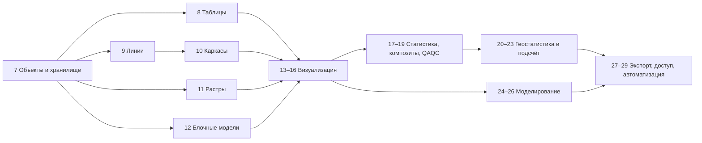

# План разработки BedrockForge

ГГИС уровня Micromine / Leapfrog в браузере. Документ описывает целевую структуру системы и порядок, в котором Claude реализует функционал: импорт → визуализация → статистика → геостатистика → моделирование.

Нумерация продолжает уже выполненные этапы 0–6.

## 1. Что уже есть

| Этап | Сделано | Ограничение, которое снимает этот план |
|---|---|---|
| 0–2.2 | Чтение Micromine DAT, CSV/TXT, Excel; мастер назначения колонок | Только три типа таблиц: Collar, Survey, Assay |
| 3 | PostgreSQL + PostGIS, миграции, проекты | Нет хранилища для линий, каркасов, растров, блочных моделей |
| 4 | Аудит данных, 27 правил, отчёт в Excel | Правила только для скважин |
| 5 | План, Разрез, Колонка, 3D (three.js), траектории | Показываются только скважины; нет слоёв и легенд |
| 6 | Лента, реестр команд, ассистент Claude, MCP | Нет авторизации; диалоги не сохраняются |
| 7 (часть) | Таблица `dataset`, дерево данных, независимые наборы скважин; одно 3D-окно: виды Y/X, Z/X, Z/Y, разрез с окном отсечения «от/до» | Фоновые задания не сделаны |
| 9 (часть) | Линии: Micromine STR, Surpac STR (текст), DXF | Нет точек, DWG, двоичного Surpac STR |
| 10 (часть) | Каркасы: Micromine TRIDB, DXF; сечение плоскостью разреза | Нет Surpac DTM, Datamine, OBJ, STL; нет проверки самопересечений |
| 11 (часть) | Растры: JPG, PNG, TIFF, BMP; привязка GeoTIFF, world-файл, TAB, GRF; растры в вертикальной плоскости (GRF с Z, по линии разреза, вручную) | Нет привязки по опорным точкам в интерфейсе, пирамиды тайлов, натягивания на ЦМР |

## 2. Целевая структура

### 2.1. Типы объектов проекта

Сейчас данные проекта — три жёсткие таблицы. Дальше всё, что загружено или рассчитано, становится **объектом** (набором данных) одного из типов.

| Тип объекта | Содержимое | Где хранится |
|---|---|---|
| Скважины | Collar, Survey, интервальные таблицы (пробы, литология, плотность, геотехника) | PostgreSQL (как сейчас) |
| Точки | Координаты + атрибуты (геохимия, съёмка, композиты) | Parquet |
| Линии (стринги) | Полилинии и полигоны с атрибутами, слои | Parquet |
| Каркасы | Треугольные сетки: поверхности (ЦМР) и замкнутые тела | Двоичный файл вершин и индексов |
| Растры | Изображения с привязкой: в плане, в вертикальной плоскости, натянутые на поверхность | Исходный файл + пирамида тайлов |
| Блочные модели | Блоки и субблоки с атрибутами, параметры сетки, поворот | Parquet, запросы через DuckDB |
| Расчётные | Вариограммы, параметры оценки, отчёты, графики | PostgreSQL (JSONB) |

Общие сведения каждого объекта — в новой таблице `dataset`: тип, имя, папка в дереве, охват, система координат, схема атрибутов, источник (файл, задание импорта или расчёт-родитель).

### 2.2. Структура кода

| Путь | Назначение | Состояние |
|---|---|---|
| `api/app/formats/` | Чтение и запись форматов. Каждый формат: `detect`, `inspect`, `read`, позже `write` | Расширяется |
| `api/app/datasets/` | Модель объектов, файловое хранилище, охват, схема атрибутов | Новый |
| `api/app/jobs/` | Фоновые задания с прогрессом и отменой (импорт, оценка, вариограммы) | Новый |
| `api/app/geo/` | Геометрия: траектории, сечение сеток плоскостью, точка-в-теле, триангуляция | Расширяется |
| `api/app/stats/` | Статистика, композитирование, QAQC | Новый |
| `api/app/geostat/` | Вариография, оценка (NN, IDW, кригинг), валидация, подсчёт | Новый |
| `api/app/modeling/` | ЦМР, операции с каркасами, неявное моделирование | Новый |
| `web/src/scene/` | Слои, формы отображения, легенды, фильтры — общие для 3D, Плана и Разреза | Новый |
| `web/src/viz/` | Отрисовка по типам объектов | Расширяется |
| `web/src/charts/` | Гистограммы, графики вероятности, вариограммы, swath plot | Новый |
| `web/src/shell/` | Лента, окна, реестр команд | Есть |

### 2.3. Технические решения

| Вопрос | Решение | Почему |
|---|---|---|
| Большие таблицы (блоки, композиты) | Parquet + DuckDB | Колоночное чтение и агрегаты по миллионам блоков без загрузки в память |
| Передача в браузер | Двоичные массивы (Arrow / typed arrays), не JSON | Блочные модели и сетки в JSON не помещаются |
| Тяжёлые расчёты | Фоновые задания; numpy, scipy, numba | Кригинг и вариограммы идут минуты, интерфейс не должен ждать |
| DXF | Библиотека `ezdxf` | Открытая, читает ASCII и двоичный DXF |
| DWG | Преобразование в DXF на сервере внешним конвертером | Формат закрытый; см. раздел 7 |
| TIFF / GeoTIFF | `rasterio` (GDAL) | Привязка, большие файлы, пирамиды |
| Графики | Свои SVG-компоненты на модулях D3 | Нужны логарифмические и вероятностные оси, связь выделения с 3D |
| Проверка расчётов | Эталонные наборы GSLIB и результаты Micromine на данных проекта | Тот же подход, что с траекториями на этапе 5 |

### 2.4. Правило для каждого этапа

Этап считается завершённым, когда есть всё из списка:

- чтение или расчёт в `api/` с тестами на синтетических данных;
- проверка на реальных файлах проекта (файлы в git не попадают);
- эндпоинты API и экран или слой в интерфейсе;
- команды в `web/src/shell/registry.ts` — их сразу получают лента, палитра, Claude и MCP;
- инструмент чтения данных для ассистента в `api/app/assistant/tools.py`;
- миграция БД и раздел в `README.md`.

Один этап — одна ветка и один pull request. Каждый этап импорта включает простейшее отображение объекта, чтобы результат можно было проверить глазами; полноценная настройка вида — в фазе B.

## 3. Порядок реализации

| Веха | После этапа | Что получает геолог |
|---|---|---|
| M1 «Все данные загружаются» | 12 | Скважины, линии, каркасы, растры и блочные модели в одном проекте |
| M2 «Просмотр как в Vizex» | 16 | Слои, легенды, разрезы, запросы к объектам, печать разрезов |
| M3 «Анализ данных» | 19 | Статистика, композиты, QAQC |
| M4 «Оценка ресурсов» | 23 | Вариограммы, блочная модель, swath plot, отчёт по ресурсам |
| M5 «Моделирование» | 26 | Оцифровка, каркасы, неявные модели |

## 4. Фаза A. Импорт данных

### Этап 7. Объекты проекта и хранилище

Основа для всех следующих этапов. Нового функционала для геолога почти нет.

- Таблица `dataset`, файловое хранилище, реестр форматов с единым интерфейсом.
- Фоновые задания: очередь, прогресс, отмена, журнал.
- Мастер импорта: определение формата и типа объекта → параметры → предпросмотр → сохранение.
- Дерево проекта: папки и объекты всех типов, переименование, удаление.
- Скважины остаются в текущих таблицах и показываются в дереве как объект.

### Этап 8. Табличные данные: расширение

| Что | Детали |
|---|---|
| Произвольные интервальные таблицы | Литология, плотность, геотехника, минерализация; несколько таблиц на проект |
| Точечные таблицы | Геохимия, съёмка, любые X/Y/Z + атрибуты |
| Micromine DAT любой структуры | Чтение уже есть; снимается привязка к Collar/Survey/Assay |
| Старый Excel `.xls` | Сейчас не поддерживается |
| Режимы загрузки | Заменить, дополнить, обновить по ключу (сейчас только замена) |
| Шаблоны импорта | Сохранённое назначение колонок, пакетная загрузка нескольких файлов |
| Справочники кодов | Коды литологии с цветами и штриховками; проверка кодов при импорте |
| Аудит | Правила для новых таблиц: перекрытия, разрывы, неизвестные коды |

### Этап 9. Линии и точки

| Формат | Чтение | Особенности |
|---|---|---|
| DXF | `ezdxf`: POINT, LINE, POLYLINE, LWPOLYLINE, 3D-полилинии, TEXT; слои и цвета | Единицы и система координат задаются при импорте |
| DWG | Конвертер DWG → DXF, дальше как DXF | Требует решения по конвертеру |
| Micromine STR | Та же структура, что DAT; поля EAST, NORTH, RL, STRING, JOIN | Используется готовый читатель DAT |
| Surpac STR | Текст: номер стринга, **Y, X**, Z, описания; сегменты разделены нулевой записью | Порядок Y перед X; есть двоичный вариант |

Отображение: линии в Плане, Разрезе (пересечение с коридором) и 3D.

### Этап 10. Каркасные модели

| Формат | Чтение | Особенности |
|---|---|---|
| DXF | 3DFACE, POLYFACE, MESH | Сшивка совпадающих вершин |
| Surpac DTM | Треугольники со ссылками на точки парного STR | Нужны оба файла |
| Micromine TRIDB | База SQLite с несколькими каркасами и атрибутами | В запросе не указан, но это основной формат каркасов Micromine |
| Datamine | Пара файлов DM: треугольники и точки | Использует читатель DM этапа 12 |
| OBJ, STL | Простые открытые форматы | Обмен с Leapfrog и другими системами |

Проверка каркаса при импорте: замкнутость, согласованность нормалей, вырожденные треугольники, самопересечения; объём и площадь.

### Этап 11. Растровые данные

| Что | Детали |
|---|---|
| Форматы | JPG, PNG, TIFF, GeoTIFF |
| Привязка из файла | Теги GeoTIFF, файлы привязки `.jgw`, `.pgw`, `.tfw` |
| Ручная привязка в плане | По 2–4 опорным точкам |
| Привязка в разрезе | Изображение в вертикальной плоскости по трём точкам (сканы разрезов) |
| Большие изображения | Пирамида тайлов, подгрузка по масштабу |
| Рельеф | GeoTIFF с высотами → поверхность-сетка |
| Отображение | Подложка в Плане, плоскость в 3D, натягивание на ЦМР |

### Этап 12. Блочные модели

| Формат | Чтение | Особенности |
|---|---|---|
| Micromine DAT | Таблица: центры EAST, NORTH, RL и размеры `_EAST`, `_NORTH`, `_RL` | Поворот модели в файле не хранится — задаётся при импорте |
| Datamine DM | Двоичный, страничный, одинарная и расширенная точность; поля XC, YC, ZC, XINC, YINC, ZINC, IJK и прототип модели | Формат описан публично; читатель пишется свой |
| Текст / CSV | Центры, размеры, атрибуты; назначение колонок через мастер | Определение сетки по данным |

- Описание модели: начало, размеры родительского блока, число блоков, субблоки, поворот.
- Проверка: перекрытия и пропуски блоков, блоки вне сетки, пустые атрибуты.
- Сводка: число блоков, объём, статистика по атрибутам.
- Отображение на этом этапе — срез по уровню и отфильтрованные блоки; полная отрисовка в этапе 15.

## 5. Фаза B. Система визуализации

### Этап 13. Слои и формы отображения

- Единая сцена для 3D, Плана и Разреза: один список слоёв, одна настройка — все виды.
- Форма отображения для каждого типа: цвет по атрибуту, размер, толщина, прозрачность, подписи.
- Редактор легенд: числовые интервалы, категории, сохранённые наборы цветов, общие для проекта.
- Фильтры по выражениям над атрибутами (`AU >= 0.5 AND LITH = 'QV'`).
- Сохранённые сцены: набор слоёв, камера, разрез.

### Этап 14. Разрезы и срезы

- Менеджер разрезов: серия по профилям с шагом, толщина коридора, произвольная плоскость.
- Сечение каркасов и блочной модели плоскостью разреза; отсечение в 3D.
- План на уровне (горизонт), растры в разрезе.
- Синхронизация окон: разрез, выбранный в Плане, показывается в 3D и в окне Разреза.

### Этап 15. Большие данные в 3D

| Объект | Приём | Цель |
|---|---|---|
| Блочная модель | Только внешние грани, инстансы, фильтр на сервере | 5 млн блоков, плавное вращение |
| Каркасы | Индексированные буферы, упрощение для дальних планов | 10 млн треугольников |
| Скважины | Объединённая геометрия, подписи по масштабу | 10 тыс. скважин |
| Передача | Двоичные массивы, разбор в web worker | Открытие сцены за секунды |

### Этап 16. Работа с объектами и вывод

- Запрос к любому объекту по клику: атрибуты блока, треугольника, интервала.
- Измерения: расстояние, угол, площадь, азимут и падение.
- Скважины: графики содержаний вдоль ствола, литология штриховкой, подписи значений.
- Печать: лист разреза или плана с рамкой, сеткой координат, масштабом и легендой → PDF, SVG, PNG.

## 6. Фазы C–F. Анализ, геостатистика, моделирование, платформа

### Фаза C. Статистика и подготовка данных

| Этап | Модуль | Состав |
|---|---|---|
| 17 | Статистика | Описательная статистика по доменам; гистограмма (в т. ч. логарифмическая); график накопленной вероятности; ящики с усами; диаграмма рассеяния с регрессией; матрица корреляций; Q-Q. Выделение на графике подсвечивает пробы в 3D |
| 18 | Композиты и домены | Композитирование по длине, уступам, геологии; кодирование проб каркасами; объединение интервальных таблиц; анализ ураганных проб (top-cut); декластеризация |
| 19 | QAQC | Стандарты (контрольные карты), бланки, дубликаты (рассеяние, HARD, Томпсон–Ховарт), сводный отчёт |

### Фаза D. Геостатистика и подсчёт ресурсов

| Этап | Модуль | Состав |
|---|---|---|
| 20 | Вариография | Экспериментальные вариограммы: всенаправленная, направленные, вдоль скважин; карта вариограмм; интерактивная подгонка модели (самородок + до трёх структур); эллипсоид анизотропии в 3D |
| 21 | Блочная модель и оценка | Пустая модель по каркасам с субблоками; кодирование; NN, IDW, обычный и простой кригинг; эллипсоид поиска, несколько проходов, секторы, ограничения по скважинам; перекрёстная проверка; анализ окрестности кригинга |
| 22 | Валидация модели | **Swath plot** по X, Y, Z: модель, композиты, NN, число проб; сравнение глобальной статистики; кривые «содержание–тоннаж»; сравнение гистограмм |
| 23 | Классификация и отчёт | Категории по проходу, расстоянию, числу проб или каркасу; плотность; тоннаж, содержание, металл по доменам, категориям и бортам; отчёт в Excel и PDF |

### Фаза E. Моделирование

| Этап | Модуль | Состав |
|---|---|---|
| 24 | Линии и поверхности | Оцифровка в Плане и Разрезе с привязкой; редактирование; ЦМР из точек и линий; изолинии; объём между поверхностями |
| 25 | Операции с каркасами | Сшивка контуров разрезов в тело; булевы операции; обрезка поверхностью; исправление ошибок |
| 26 | Неявное моделирование | Интерполяция RBF по контактам и содержаниям; оболочки литологии и содержаний; анизотропия и тренды |

### Фаза F. Платформа

| Этап | Модуль | Состав |
|---|---|---|
| 27 | Экспорт | CSV, Excel, Micromine DAT и STR, DXF, Datamine DM, OBJ, GeoTIFF; архив проекта |
| 28 | Доступ и история | Авторизация, роли, история изменений объектов, отмена действий, пересчёт систем координат |
| 29 | Автоматизация Claude | Запись журнала команд в повторяемый сценарий; отчёты по запросу («проверь модель и собери отчёт»); сохранение диалогов |

Этап 28 переносится раньше, если систему нужно открыть в сеть до вехи M4: сейчас у API и MCP авторизации нет.

## 7. Риски и открытые решения

| Вопрос | Суть | Предложение |
|---|---|---|
| DWG | Формат закрытый. ODA File Converter бесплатный, но ставится отдельно и не распространяется вместе с системой; LibreDWG открытый (GPLv3), читает не все версии | Начать с ODA как необязательного компонента; без него — сообщение «сохраните в DXF» |
| Форматы Micromine | STR, блочные DAT и TRIDB публично не описаны | Разбор по образцам, как сделано для DAT на этапе 2.0 |
| Размер моделей | Предел браузера по памяти | Фильтрация и срезы на сервере, цели этапа 15 уточнить по реальным моделям |
| Точность расчётов | Кригинг и вариограммы должны совпадать с Micromine | Сверка на данных проекта, допуски фиксируются в тестах |
| Стандарт отчётности | ГКЗ, JORC или оба | Решить до этапа 23 |

## 8. Что нужно от пользователя

Разбор полученных образцов — в `docs/FORMATS.md`.

| К этапу | Образцы файлов и решения | Получено |
|---|---|---|
| 8 | Таблицы литологии, плотности, QAQC; справочник кодов | — |
| 9–10 | DXF, DWG, STR Micromine и Surpac, DTM Surpac, TRIDB | STR Micromine, DXF (polyface), TRIDB |
| 11 | Растры с привязкой и без; сканы разрезов | JPG + JGW, TAB, GRF |
| 12 | Блочные модели: Micromine DAT, Datamine DM, текст; параметры поворота |
| 20–22 | Вариограммы, оценённая модель и swath plot из Micromine на тех же данных — для сверки |
| 23 | Требуемая форма отчёта по ресурсам |
